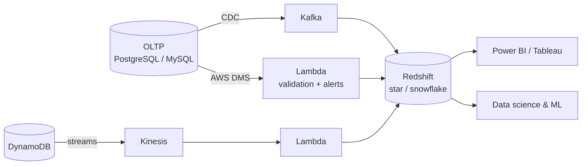

 

-203a43?style=flat-square)

---

## 👋 About me

Results-driven **Senior Data Engineer with 4+ years of experience** designing scalable data pipelines, data lakes, ETL/ELT workflows and analytical models for reporting, dashboards and AI initiatives. I work across **AWS, Azure and GCP**, and I'm happiest in cross-functional, international teams where data quality and performance matter.

- 🔄 **Real-time ingestion:** Kafka + Change Data Capture from multiple OLTP sources into the warehouse
- 🏛️ **Warehouse & lakehouse design:** star/snowflake schemas in Redshift, medallion architecture on Databricks and Delta Lake
- 🛢️ **Database engineering:** PostgreSQL and MySQL on RDS, query/index tuning, audit logging, DR planning
- 🤖 **AI-adjacent:** LLM-assisted tooling for ETL, ML-ready data schemas
- 🎓 **Currently:** completing an MS in Data Science at NED University (expected Dec 2026)
- 🤝 **Open to:** consultations on data problems that data engineering or data science can solve

---

## 💼 Experience

### Senior Data Engineer / Senior Database Developer · *PublishEX Solutions Pvt. Ltd (FinTech)*
`Mar 2024 – Present`

- Built **Kafka + CDC** ETL/ELT pipelines for real-time ingestion from multiple OLTP sources into the warehouse
- Designed **Star and Snowflake schemas in AWS Redshift** for fast reporting and analytics workloads
- Automated warehouse migration with **AWS DMS + Lambda**, with automatic validation and email alerts on any mismatch, within a PCI-compliant environment
- Built a **DynamoDB → Kinesis → Lambda** pipeline for near-real-time warehouse updates
- Cut data-warehouse **CPU utilisation by 40%** through SQL and indexing optimisation, with a significant memory reduction
- Diagnosed and resolved **20+ pipeline incidents** (schema drift, failed jobs, integrity errors) to keep availability high
- Added **audit logging and automated triggers** on critical financial tables for security and compliance
- Engineered a **change-management system** using Liquibase: schema replication, versioning and automated comparisons
- Designed and tested **disaster-recovery protocols** and documented data flows, transformation logic and business rules

### Data Engineer / Software Engineer · *Xloop Digital*
`Jul 2022 – Mar 2024`

- Designed and maintained data infrastructure and ETL pipelines for ingestion, transformation, storage and reporting
- Integrated OLTP databases and external APIs into OLAP models
- Integrated **LLM-powered** recommendations into enterprise data tooling, simplifying ETL pipeline construction for analysts
- Built data schemas supporting machine-learning models
- Ran CI/CD on **Azure DevOps** with Git best practices, reducing development cycle time

---

## 🧰 Tech stack

**Languages**

-336791?style=for-the-badge&logo=postgresql&logoColor=white)

**Databases**

**Streaming & processing**

**Cloud & warehousing**

**DevOps & tooling**

**BI & apps**

<b>Full skills breakdown</b>

| Area | Skills |
|------|--------|
| ETL / ELT & CDC | Kafka, AWS Kinesis, AWS DMS, AWS Glue, AWS Lambda, Azure Data Factory, CDC, Liquibase |
| Modelling | Star & snowflake schemas, 3NF, fact/dimension design, Data Vault, OLAP cubes, dbt (familiar) |
| Modern platforms | Databricks, Snowflake, Azure Synapse, Spark, Delta Lake, Medallion architecture |
| File formats | Parquet, Avro, ORC, JSON, CSV |
| Other | REST APIs, web scraping (BeautifulSoup, Scrapy, Selenium), Generative AI / LLMs, JIRA, Azure DevOps |

---

## 🏗️ How I think about data movement

A simplified view of the architecture patterns I build:

The principles I keep coming back to:

1. **Idempotent by design.** Replays and retries must never corrupt a target table.
2. **Schema change is normal.** Pipelines should survive a new column, not page someone at night.
3. **Money data needs reconciliation.** Row counts and balances are validated, not assumed.
4. **Operate what you build.** Monitoring, audit trails and a tested recovery plan are part of the feature.

---

## 🎓 Education & certifications

| | |
|---|---|
| **MS Data Science** · NED University of Engineering & Technology | Expected Dec 2026 |
| **BS Electrical Engineering (Computer Systems)** · FAST-NUCES | Jul 2022 · Dean's List (Fall '21, Spring '22) |

**Certifications:** Data Engineering BootCamp (Emeritus) · Data Engineering Specialization (DataCamp) · Generative AI with LLMs (Coursera) · Data Engineering using Databricks (Udemy) · SQL (DataCamp) · Project Management (Coursera)

---

## 🔬 Final year project

**IoT-Based Smart Surveillance Using AI and Blockchain** *(Aug 2021 – May 2022)*: a smart surveillance system with IoT sensors and AI anomaly detection, protected by blockchain against unauthorised access, removing the need for constant manual monitoring across screens.

## 🏆 Highlights

- Game Development Competition Head, Procom '22 (IEEE)
- Head of Marketing & Promotion, IEEE '22: led FAST's first hardware/software project display event
- Dean's List, Fall '21 and Spring '22

---

## 📈 GitHub stats

---

## 📫 Let's connect

*Ask me about: CDC, Kafka, Redshift, lakehouse design, RDS operations, Power BI.*

